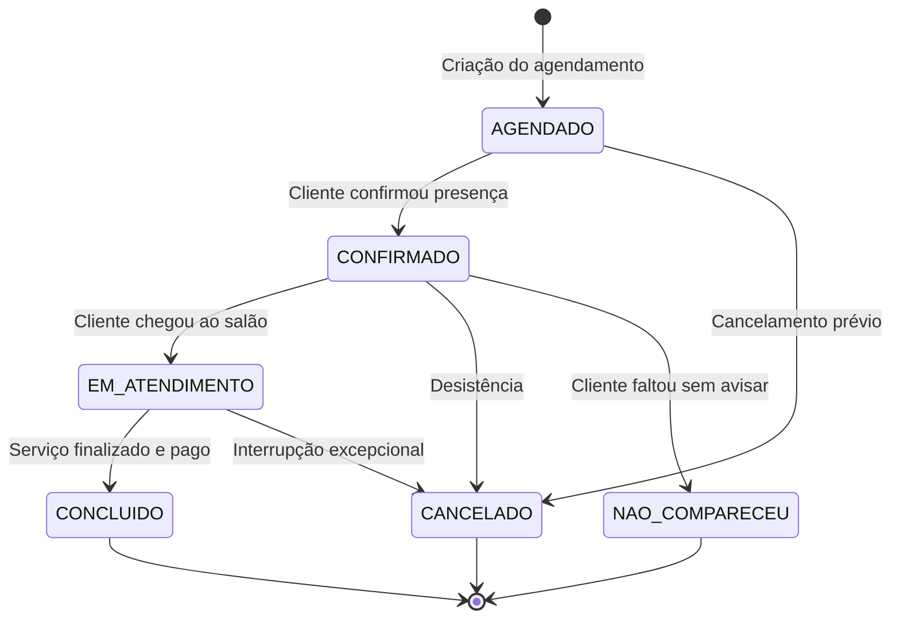

# CLARIFICATIONS — SALON MANAGER BACKEND
**Fase do Spec Kit:** `/speckit.clarify`

Este documento consolida os esclarecimentos de cenários de borda (edge cases), regras de tolerância, invariantes de negócio, concorrência, consistência contábil e políticas operacionais do sistema **Salon Manager**.

---

## 1. Concorrência e Prevenção de Conflitos na Agenda

### 1.1 Cenário de Borda: Concorrência Simultânea (Race Condition)
- **Problema:** Dois operadores ou clientes tentam agendar o mesmo colaborador no mesmo horário exatamente no mesmo milissegundo.
- **Resolução Arquitetural:**
  1. **Algoritmo de Verificação de Sobreposição:**
     Dois agendamentos $A$ e $B$ do mesmo funcionário colidem se e somente se:
     $$\text{A.inicio} < \text{B.termino} \quad \text{E} \quad \text{A.termino} > \text{B.inicio}$$
     Agendamentos com status `CANCELADO` ou `NAO_COMPARECEU` são explicitamente desconsiderados nessa checagem.
  2. **Controle de Bloqueio Concorrente:**
     - Na transação de criação/atualização de agendamento, realizamos uma consulta no repositório com lock pessimista compartilhado ou lock pessimista exclusivo no colaborador (`PESSIMISTIC_WRITE`) durante a verificação de intervalo.
     - O agendamento possui controle de concorrência otimista (`@Version Long version`) para evitar edições simultâneas de status ou horários por operadores distintos.
  3. **Intervalo entre Atendimentos:**
     - O horário de término de um atendimento pode ser exatamente o horário de início do seguinte (ex: 14:00 - 15:00 e 15:00 - 16:00 não colidem).

### 1.2 Regras de Validação de Horários
- **Data no Passado:** Agendamentos não podem ser criados com `start_time` anterior ao horário atual (`ZoneId.of("America/Sao_Paulo")`).
- **Horário de Expediente:**
  - Parâmetros configuráveis de abertura e fechamento do salão (ex: 08:00 às 20:00).
  - O atendimento completo (`start_time` até `end_time`) deve caber dentro do horário de expediente.
- **Funcionário ou Serviço Inativo:**
  - Rejeição imediata (`422 Unprocessable Entity` ou `400 Bad Request`) se `employee.active == false` ou `service.active == false`.

---

## 2. Ciclo de Vida do Agendamento e Conexão Financeira

### 2.1 Diagrama de Estados do Agendamento


### 2.2 Gatilhos Financeiros e Comissões
1. **Ao criar o agendamento (`AGENDADO`):**
   - Não gera lançamento financeiro efetivo nem comissão. O valor previsto é apenas informativo (`estimated_price`).
2. **Ao transitar para `CONCLUIDO`:**
   - **Geração de Receita:** Cria automaticamente uma `FinancialTransaction` com:
     - `type`: `INCOME`
     - `category`: `"SERVICO"`
     - `amount`: valor efetivo do serviço
     - `status`: `COMPLETED`
     - `transaction_date`: data da conclusão
   - **Geração de Comissão:**
     - Identifica a taxa aplicável:
       $$\text{Taxa Aplicada} = \begin{cases} \text{service.customCommissionRate}, & \text{se não for nulo} \\ \text{employee.defaultCommissionRate}, & \text{caso contrário} \end{cases}$$
     - Calcula:
       $$\text{commissionAmount} = \text{serviceAmount} \times \left(\frac{\text{taxa}}{100}\right)$$
       $$\text{salonAmount} = \text{serviceAmount} - \text{commissionAmount}$$
     - Grava na tabela `commissions` com status `PENDING` (aguardando pagamento ao funcionário).
3. **Se o agendamento for `CANCELADO` ou `NAO_COMPARECEU`:**
   - Nenhuma comissão é gerada.
   - Nenhuma receita efetiva é registrada.

---

## 3. Imutabilidade e Regras Contábeis do Fechamento Mensal

### 3.1 Integridade de Períodos Fechados
- **Invariante:** Lançamentos com data dentro de um mês/ano já fechado com status `CLOSED` **NÃO podem** ser criados, editados ou excluídos.
- **Comportamento em Tentativa de Violação:**
  - `POST /api/financial/transactions` com data em mês fechado $\rightarrow$ Erro `409 Conflict` ("O período contábil do mês MM/AAAA já se encontra encerrado.").
  - `PUT /api/financial/transactions/{id}` ou `DELETE` em período fechado $\rightarrow$ Erro `409 Conflict`.
  - Agendamento concluído retroativamente em mês fechado $\rightarrow$ Rejeição.

### 3.2 Processo de Reabertura Controlada
1. O administrador aciona `POST /api/monthly-closings/{id}/reopen` enviando obrigatoriamente `auditNotes` (mínimo 15 caracteres justificando o motivo).
2. O sistema altera o status do fechamento para `REOPENED` e registra quem reabriu e em qual instante.
3. Enquanto estiver `REOPENED`, correções podem ser realizadas.
4. Para fechar novamente, o administrador aciona a consolidação que recomputa os valores com base no estado atual do banco, atualiza o snapshot e altera o status de volta para `CLOSED`.

---

## 4. Política de Soft Delete e Integridade Referencial

- **Funcionários:**
  - Não podem ser fisicamente deletados caso possuam agendamentos, serviços prestados ou comissões associadas.
  - Ao desativar (`DELETE /api/employees/{id}`), o sistema seta `active = false`.
  - O login do funcionário (caso possua `user_id` associado) também tem `user.active` setado para `false`, impedindo novos acessos ao sistema.
- **Serviços:**
  - Ao desativar (`DELETE /api/services/{id}`), o serviço não aparece mais para novos agendamentos, mas todo o histórico anterior e fechamentos passados preservam a referência.
- **Clientes:**
  - Desativação lógica com preservação completa do histórico de atendimento e notas.

---

## 5. Bootstrap do Administrador e Autenticação

### 5.1 Carga Inicial do Primeiro Administrador (Seed Seguro)
- No momento da inicialização da aplicação (`CommandLineRunner`), o sistema verifica se existe algum usuário na tabela `users`.
- Caso não exista:
  - Cria o usuário administrador padrão com credenciais seguras configuradas via variáveis de ambiente (`ADMIN_EMAIL` e `ADMIN_PASSWORD`), com fallback para ambiente de desenvolvimento local devidamente documentado no `.env.example`.
  - A senha é gravada com hash BCrypt com fator de custo 12.
- Adicionalmente, o endpoint `POST /api/auth/register-admin` é protegido para permitir apenas que um administrador logado crie outros administradores (ou público apenas se a base estiver vazia).

### 5.2 Expiração e Revogação de Tokens JWT
- `Access Token`: Validade de 2 horas. Contém `sub` (ID do usuário), `email` e claim `role` (`ROLE_ADMIN` ou `ROLE_EMPLOYEE`).
- `Refresh Token`: Validade de 7 dias, armazenado de forma segura para renovação sem necessidade de reautenticação contínua.
- Logout: Endpoint `/api/auth/logout` que invalida o contexto e orienta o cliente a descartar o token no frontend.

---

## 6. Precisão Numérica e Moeda

- Todos os campos de valor monetário (`price`, `amount`, `gross_revenue`, `net_result`, `commission_amount`, etc.) utilizam `BigDecimal`.
- Configuração do Jackson ObjectMapper para serializar `BigDecimal` com formatação decimal precisa (duas casas decimais, e.g. `150.00`) e sem notação científica.
- Em todas as divisões ou cálculos percentuais:
  ```java
  BigDecimal commissionAmount = serviceAmount
      .multiply(appliedRate)
      .divide(BigDecimal.valueOf(100), 2, RoundingMode.HALF_EVEN);
  ```
