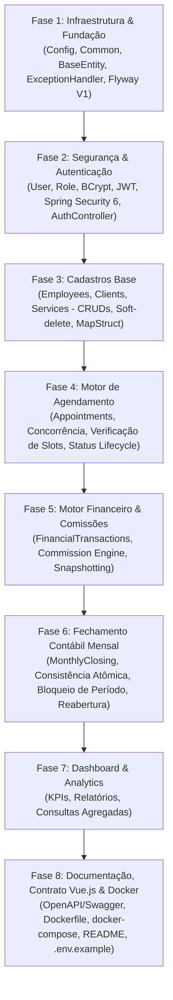

# PLAN — SALON MANAGER BACKEND
**Fase do Spec Kit:** `/speckit.plan`

Este documento define o plano arquitetural e a estratégia de engenharia para a implementação do backend do sistema **Salon Manager**.

---

## 1. Abordagem de Construção e Ordem dos Módulos

Para garantir que cada componente seja construído sobre alicerces estáveis e testáveis, o desenvolvimento será organizado nas seguintes fases estruturadas:

---

## 2. Detalhamento das Fases de Implementação

### Fase 1: Infraestrutura, Base e Banco de Dados
1. **Configuração de Ambiente:**
   - Criação do `.env.example` com variáveis essenciais: `DB_URL`, `DB_USER`, `DB_PASSWORD`, `JWT_SECRET`, `JWT_EXPIRATION_HOURS`, `ADMIN_EMAIL`, `ADMIN_PASSWORD`.
   - Configuração de `application.yaml` e `application-test.yaml`.
2. **Entidade Base e Auditoria:**
   - Criação de `BaseEntity` com `@Id UUID id`, `@CreationTimestamp createdAt`, `@UpdateTimestamp updatedAt`.
3. **Mecanismo Global de Tratamento de Erros:**
   - Criação de `GlobalExceptionHandler` (`@RestControllerAdvice`).
   - Implementação de classes de erro de domínio:
     - `ResourceNotFoundException` (404)
     - `BusinessException` (400)
     - `ScheduleConflictException` (409)
     - `ClosedPeriodException` (409)
     - `UnauthorizedException` / `ForbiddenException` (401 / 403)
   - Padronização do payload conforme RFC 7807 (Problem Details).
4. **Migração Inicial com Flyway (`V1__initial_schema.sql`):**
   - Criação de todas as tabelas, índices, chaves estrangeiras e restrições de integridade conforme especificado em `specs/specifications.md`.

---

### Fase 2: Segurança e Autenticação (`modules/auth`)
1. **Camada de Dados do Usuário:**
   - Entidade `User` com atributos de login, enum `UserRole` (`ROLE_ADMIN`, `ROLE_EMPLOYEE`).
   - `UserRepository` com busca por email.
2. **Componentes JWT e Spring Security 6:**
   - `JwtTokenService`: Geração, decodificação e validação de tokens JWT (JJWT).
   - `SecurityConfiguration`: Configuração de `SecurityFilterChain` *stateless*, desabilitação de CSRF, liberação de rotas públicas (`/api/auth/login`, `/api/auth/refresh`, `/swagger-ui/**`, `/v3/api-docs/**`) e restrição das demais.
   - `JwtAuthenticationFilter`: Interceptação do header `Authorization: Bearer <token>` e injeção do `UserPrincipal` no `SecurityContextHolder`.
   - `CustomUserDetailsService`: Carregamento do usuário para o Spring Security.
3. **Casos de Uso de Autenticação:**
   - `AuthService`:
     - Login com verificação de credenciais via `AuthenticationManager` / `BCryptPasswordEncoder`.
     - Refresh token para renovação sem expiração imediata.
     - Bootstrap seguro: `AdminSeedRunner` (`CommandLineRunner`) criando o administrador inicial caso a base esteja vazia.
4. **Endpoints (`AuthController`):**
   - `POST /api/auth/login`
   - `POST /api/auth/refresh`
   - `GET /api/auth/me`

---

### Fase 3: Cadastros Base (`modules/employee`, `modules/client`, `modules/service`)
1. **Módulo de Colaboradores (`employee`):**
   - Entidade `Employee`, Repositório `EmployeeRepository`.
   - `EmployeeService`: Cadastro, atualização, listagem paginada com filtro por nome e status, e desativação lógica (`active = false`).
   - `EmployeeMapper` (MapStruct).
   - `EmployeeController`.
2. **Módulo de Clientes (`client`):**
   - Entidade `Client`, `ClientRepository`.
   - `ClientService`: CRUD com paginação e busca por nome/telefone/email, desativação lógica.
   - `ClientMapper` e `ClientController`.
3. **Módulo de Serviços (`service`):**
   - Entidade `ServiceEntity`, `ServiceRepository`.
   - `ServiceManagementService`: Cadastro com preço (`BigDecimal`), duração e taxa de comissão opcional.
   - `ServiceMapper` e `ServiceController`.

---

### Fase 4: Motor de Agendamentos & Disponibilidade (`modules/appointment`)
1. **Modelagem e Repositório:**
   - Entidade `Appointment` com referências a `Client`, `Employee`, `ServiceEntity`.
   - Campo `@Version Long version` para controle de concorrência otimista.
   - Enum `AppointmentStatus`: `AGENDADO`, `CONFIRMADO`, `EM_ATENDIMENTO`, `CONCLUIDO`, `CANCELADO`, `NAO_COMPARECEU`.
   - `AppointmentRepository`: Queries especializadas com locking (`findOverlappingAppointments` com verificação de intervalo de datas).
2. **Lógica de Agendamento (`AppointmentService`):**
   - Cálculo automático do `end_time = start_time.plusMinutes(service.durationMinutes)`.
   - Validações:
     - Funcionário ativo e serviço ativo.
     - Horário dentro do expediente do salão (ex: 08:00 às 20:00).
     - Ausência de conflito de agenda para o funcionário.
   - Transição de status controlada com validação de fluxo de estados.
3. **Cálculo de Disponibilidade (`AvailabilityService`):**
   - Endpoint para retornar slots livres para um colaborador em determinada data com base na duração do serviço solicitado.
4. **Controller (`AppointmentController`):**
   - Criação, edição, cancelamento, alteração de status e consulta de disponibilidade.

---

### Fase 5: Motor Financeiro & Comissões (`modules/financial`, `modules/commission`)
1. **Módulo de Comissões (`commission`):**
   - Entidade `Commission` vinculada ao `Appointment` (1:1) e `Employee`.
   - `CommissionCalculatorService`:
     - Avalia regra de precedência: `service.customCommissionRate` > `employee.defaultCommissionRate`.
     - Realiza cálculo determinístico com `BigDecimal` (`HALF_EVEN`).
     - Grava snapshot imutável de valores (`appliedRate`, `serviceAmount`, `commissionAmount`, `salonAmount`).
2. **Módulo Financeiro (`financial`):**
   - Entidade `FinancialTransaction`, enum `TransactionType` (`INCOME`, `EXPENSE`), enum `TransactionStatus` (`PENDING`, `COMPLETED`, `CANCELLED`).
   - `FinancialTransactionService`:
     - Lançamento automático de receita ao concluir agendamento.
     - Lançamentos avulsos de despesas (aluguel, contas, insumos).
     - Validação de período fechado: Proibição de movimentação em datas de meses já encerrados.
     - Resumo financeiro (totais de receitas, despesas e saldo).
3. **Controllers (`FinancialController`, `CommissionController`).**

---

### Fase 6: Fechamento Contábil Mensal (`modules/closing`)
1. **Modelagem:**
   - Entidades `MonthlyClosing` e `MonthlyClosingItem`.
   - Restrição de unicidade no banco por `reference_year` e `reference_month`.
2. **Serviço de Fechamento (`MonthlyClosingService`):**
   - Execução em transação atômica (`@Transactional`).
   - Bloqueio contra fechamento duplicado.
   - Consolidação:
     - Soma receitas concluídas do mês.
     - Soma despesas concluídas do mês.
     - Consolidação de comissões por funcionário gerando os `MonthlyClosingItem`.
     - Cálculo do resultado líquido do salão.
     - Gravação de snapshot imutável.
   - Método de reabertura controlada (`reopenClosing`): exige `auditNotes` obrigatório e audita o responsável.
3. **Controller (`MonthlyClosingController`).**

---

### Fase 7: Dashboard & Analytics (`modules/dashboard`)
1. **`DashboardService`:**
   - Agregação de faturamento mensal, total de despesas, comissões e resultado líquido.
   - Total de agendamentos realizados vs cancelados.
   - Top 5 serviços mais demandados (quantidade e faturamento).
   - Top 5 colaboradores mais produtivos.
   - Próximos agendamentos do dia.
2. **Controller (`DashboardController`).**

---

### Fase 8: Testes Automatizados, Docker & Documentação de Integração
1. **Suíte de Testes:**
   - **Testes Unitários:**
     - `CommissionCalculatorServiceTest`: Validação de precedência de taxas, cálculo com BigDecimal e arredondamento.
     - `AppointmentServiceTest`: Validação de conflitos de horário, cálculo de duração e transições de status.
     - `MonthlyClosingServiceTest`: Consistência contábil, impedimento de duplicação e reabertura auditada.
     - `FinancialTransactionServiceTest`: Bloqueio de lançamentos em períodos fechados.
   - **Testes de Integração:**
     - `AuthControllerIT`: Fluxo completo de autenticação e proteção de rotas.
     - `AppointmentControllerIT`: Fluxo ponta a ponta de agendamento e disponibilidade.
2. **Infraestrutura Docker:**
   - `Dockerfile` multi-stage com Maven e JRE 21 leve (`eclipse-temurin:21-jre-alpine`).
   - `docker-compose.yml` orquestrando PostgreSQL 16 e o backend Spring Boot com redes e healthchecks configurados.
3. **Contrato de Integração Frontend Vue.js:**
   - Documento [`docs/frontend-integration-contract.md`](file:///home/debhg/Projetos/salon/docs/frontend-integration-contract.md) descrevendo endpoints, modelos de requests/responses, cabeçalhos de autenticação, paginação e tratamento de erros no Vue/Pinia/Axios.
4. **Documentação Geral:**
   - `README.md` completo com guia de execução local e comandos Docker.
